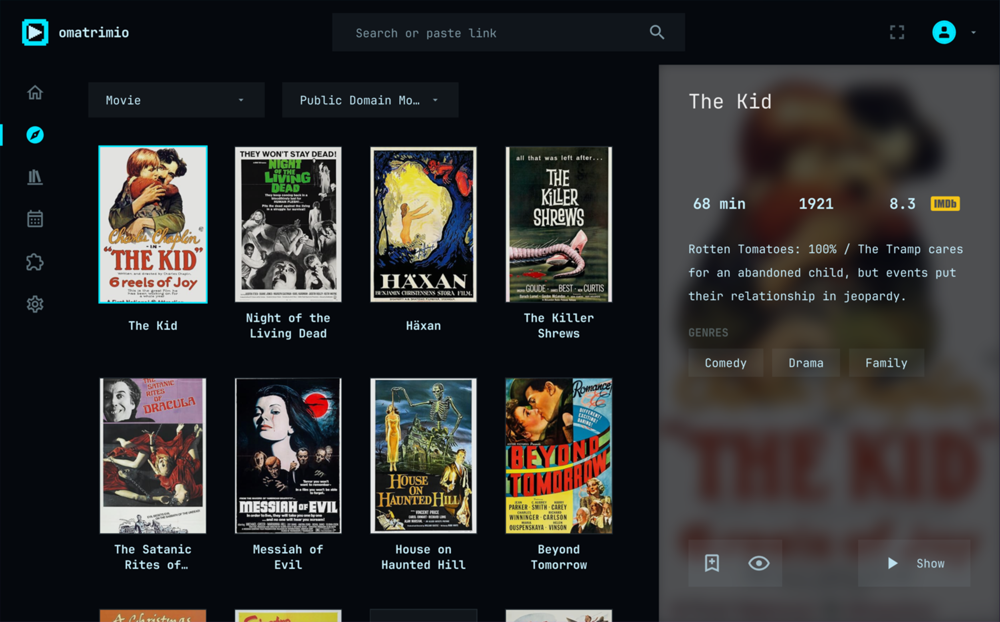
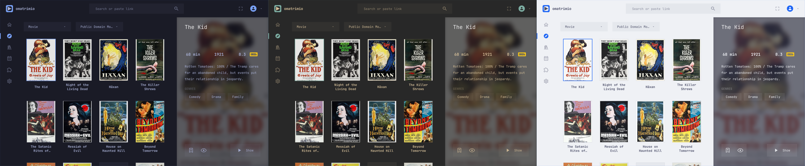

# omatrimio

Stremio, at home on Omarchy.

Stremio on Omarchy looks like a guest: its own purple, its own font, rounded
corners, a header bar. omatrimio is the same Stremio (your account, your
library, your addons, the same player) dressed as an Omarchy app. Switch
your theme and it switches with you, while it's open.



> [!IMPORTANT]
> omatrimio is an **unofficial, community-made** app. It is not affiliated
> with, endorsed by, or supported by Stremio or Smart Code OOD, and it is not
> an official Omarchy app. "Stremio" is a trademark of Smart Code OOD. Please
> bring omatrimio's bugs [here](https://github.com/Pakvothe/omatrimio/issues),
> not to Stremio's support.

## Why

- **It belongs on your desktop.** An app that ignores your theme stands out
  on a system where everything else follows it. omatrimio reads the same
  theme files the rest of Omarchy does.
- **It is still Stremio.** omatrimio doesn't reimplement anything. It runs
  the Stremio web app and restyles it as it loads, so every feature works
  and every Stremio update arrives on its own.
- **No Flatpak.** It builds and installs like any native Arch app, on
  `x86_64` and `aarch64`, and plays through the system's mpv.

## What changes

- **Your theme, live.** Colors come from the current Omarchy theme and
  change the moment you switch, with no restart. Every theme Omarchy ships,
  light and dark, is checked for readable contrast.
- **Your font and your corners.** The desktop font, and Hyprland's window
  rounding on every surface: square on Omarchy's default.
- **Omarchy's icons.** The Material Design set that Nerd Fonts carries.
- **One accent.** Play, install, and every other action use the theme's
  accent, with text that stays readable on it.
- **Cards bordered like windows.** A hairline at rest, and the accent at
  your Hyprland border width on the one in focus.
- **No header bar.** Hyprland draws the border; the app is all content.
- **A quiet side bar.** Icons only, in even rows, the current section marked
  by the accent. In a narrow window it becomes a row along the bottom.



## Install

omatrimio is for Omarchy. So far it has been tested on `aarch64`; if it
misbehaves on your machine, please
[open an issue](https://github.com/Pakvothe/omatrimio/issues).

```sh
git clone https://github.com/Pakvothe/omatrimio
cd omatrimio
bin/install
```

That builds omatrimio and installs it for your user under `~/.local`, with
no root needed. If a package it needs is missing, it stops and prints the
command that adds it. Then open **omatrimio** from the app launcher
(`Super + Space`) and sign in to your Stremio account.

To build and install an Arch package instead, run `makepkg -si` in
`pkgbuild/`. To remove a `bin/install` installation, run `bin/uninstall`.

## Hotkeys

- *Ctrl+,*: Preferences.
- *Ctrl+Q*: Quit.

Playback and navigation keys are the Stremio web app's own, listed in the
app under Settings > Shortcuts.

## Settings

Preferences (*Ctrl+,*) can bring the header bar back, point mpv at a config
directory, and remember the window's size.

A few environment variables are there for troubleshooting:

- `SERVER_PATH`: run this streaming server script instead of the downloaded
  one.
- `OMATRIMIO_CPU_RENDERING`: `1` or `0` forces drawing the interface on the
  CPU or the GPU. By default the CPU is used when the only display adapter is
  a virtual one, which fixes flickering posters in virtual machines.
- `OMATRIMIO_DEBUG`: print the web page's console to the terminal.

## The streaming server

Torrents and transcoding are handled by Stremio's streaming server, which
is Stremio's own program and isn't open source, so omatrimio doesn't
include it. On first run omatrimio downloads it from Stremio's site
(`dl.strem.io`), checks it against a pinned SHA-256, and keeps it in
`~/.local/share/omatrimio`. It runs with Node.js. Without it omatrimio still
opens, and the interface says streaming is unavailable.

## Addons and content

omatrimio ships with no addons beyond the ones the Stremio web app installs
by default, and it hosts no content. What you install and watch is up to
you, and is your responsibility under the laws where you live. The
screenshots here show the Public Domain Movies catalog.

## How it works

The Stremio web app is loaded in a WebKitGTK view over an mpv player, as in
[stremio-linux-shell](https://github.com/Stremio/stremio-linux-shell), which
omatrimio is a fork of. On top of that:

- `src/omarchy.rs` reads the theme's `colors.toml`, Hyprland's rounding and
  border width, and the desktop font, and writes a stylesheet that overrides
  the web app's palette variables. It is re-read every second and re-applied
  when something changed.
- `src/omarchy.css` is the layout: side bar, top bar, cards, artwork.
- `src/app/omarchy.js` rewrites the web app's own style rules where
  variables can't reach: fixed corner radii, text on accent backgrounds, and
  brand colors written by hand.
- `src/app/omarchy-icons.js` swaps each icon for its Material Design
  drawing. `scripts/build-icons.py` generates the table.
- `src/art.rs` and `src/app/omarchy-art.js` replace Stremio's logo, avatar,
  and empty-state artwork with omatrimio's, drawn in the theme's colors.
- `src/gpu.rs` detects virtual GPUs.
- `src/server.rs` fetches and verifies the streaming server.

Nothing in the web app is modified on disk or on the network. The changes
are styles and scripts applied to the page as it loads, and they match the
stable part of the web app's class names, so they keep working as it updates.

## Build

Needs `rust`, `gettext`, and the libraries the installer lists.

```sh
bin/build   # cargo build --release
bin/test    # unit tests
bin/run     # run from the source tree, without installing
```

Run with `OMATRIMIO_DEBUG=1` to see the page's console, or `--dev` to open
the WebKit inspector.

## Changes from stremio-linux-shell

As the GPL asks, these are the changes made to the original:

- Renamed to omatrimio, with its own application id, icon, and artwork.
  Stremio's name, logo, and artwork are not used.
- Added the Omarchy look described above.
- The header bar is off by default.
- The streaming server is downloaded on first run instead of being bundled.
- The interface is drawn on the CPU on virtual GPUs.
- Removed the Flatpak packaging and Stremio's release workflows.

## License and credits

omatrimio is free software under the [GPL-3.0](LICENSE), the license of
stremio-linux-shell, which it is based on (© Smart Code OOD).

- The Stremio web app and streaming server belong to Smart Code OOD. They
  are loaded or downloaded from Stremio's servers, not redistributed.
- Icons are from [Material Design Icons](https://pictogrammers.com/library/mdi/)
  (Apache-2.0).
- The look follows [Omarchy](https://omarchy.org), by DHH and contributors.
